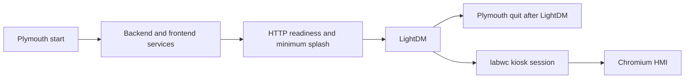

# Configuration and deployment

Last audited: 2026-10-22. Status: static source audit; no startup, install, build, flash, network probe, service command or deployment was performed. Purpose: show which source controls configuration and what running the available tooling would change. Scope: root/package entry points, environment consumers, firmware builds, EtherCAT privileges/networking, kiosk/systemd deployment and bundled copies. Installed service files, actual environment values, binaries, network state and production records were excluded.

## Package and entry-point topology

| Root | Entry / declared command | Dependencies and output |
|---|---|---|
| Workspace `package.json` | `build`, `build:frontend` → frontend build | Convenience dispatch only; no workspace aggregate backend build/test |
| `backend/package.json` | `start` → `node index.mjs`; Node test scripts | ES modules, Express, better-sqlite3/session store, serialport, busboy, cors, express-session |
| `frontend/package.json` | `dev` → Vite; `build` → TypeScript no-emit then Vite; `preview`; `launch`; `dev:full` | React 18, React Router, Socket.IO client, Tailwind, TypeScript, Vite; build writes `frontend/dist` |
| `New_version_pick&place/master/package.json` | Module package declaration | Standalone master imported by backend/CLI; no full firmware build declaration in this root |
| Root `requirements.txt` | pysoem dependency | EtherCAT environment; lower-bound dependency, not exact Python lock |
| `requirements-master-client.txt`, scripts copy | requests and python-socketio client | External vision slave CLI dependencies |

Evidence: `package.json:L1-L9`, `backend/package.json:L1-L23`, `frontend/package.json:L1-L39`, root and scripts Python requirements files. Lockfiles are dependency metadata, not evidence of the currently installed binaries. Vendored `node_modules`, virtual environments, `.pio` build/libdeps and generated frontend output were not audited as source.

`start.sh` is an active-machine startup script. It installs Node dependencies when directories are absent, copies an environment example if needed, sources `backend/.env` as shell code, defaults `ETHERCAT_AUTO_CONNECT=1`, checks service/port conflicts, starts backend, polls health, starts Vite and launches Chromium. Its cleanup sends TERM, waits roughly 5 s and then KILL. Evidence: `start.sh:L12-L34`, `start.sh:L42-L93`, `start.sh:L95-L151`. It is not an offline validation command.

The backend readiness URL in `start.sh:L103-L103` is hardcoded to port 3333 even though the conflict check uses `PORT`; Vite's `/api` proxy is also fixed to backend 3333. Plain `npm run dev --prefix frontend` uses configured port 5175 with fallback allowed; `start.sh` supplies 5173 and strictPort. Boot preview uses 5173 with strictPort. Changing a port requires checking all consumers, not only one environment variable. Evidence: `frontend/vite.config.ts:L14-L39`, `start.sh:L43-L44`, `start.sh:L103-L103`, `start.sh:L111-L120`, `scripts/plymouth/us-machine-frontend.sh.in:L13-L13`, `scripts/plymouth/us-machine-frontend.sh.in:L46-L46`.

## Source-derived configuration families

Only variable names and source defaults are documented here; no `.env` file was read. This table is a configuration map, not a full secret/value inventory.

| Family | Variables / persistence | Effect and evidence |
|---|---|---|
| Startup/API | `PORT`, `SETTINGS_API_PORT`, `VITE_PORT`, `SESSION_SECRET`, `ETHERCAT_AUTO_CONNECT` | Manual startup and boot wrappers use different port precedence; boot wrapper provides a fixed session-secret fallback when absent. `start.sh:L25-L44`; `scripts/plymouth/us-machine-headless-web.sh.in:L18-L23`, `scripts/plymouth/us-machine-headless-web.sh.in:L178-L190` |
| Pick-and-place transport | `PICK_PLACE_HOST`, `PICK_PLACE_PORT`, `PICK_PLACE_LOCAL_ADDRESS`, `PICK_PLACE_CONNECT_TIMEOUT_MS`, `PICK_PLACE_CONNECT_RETRIES`, `PICK_PLACE_CONNECT_RETRY_MS`, `PICK_PLACE_TRANSIENT_TCP` | Read by master module; persistent TCP default, optional transient mode. master `New_version_pick&place/master/pick_place_master.js:L157-L163`, `New_version_pick&place/master/pick_place_master.js:L650-L650`, `New_version_pick&place/master/pick_place_master.js:L796-L796`, `New_version_pick&place/master/pick_place_master.js:L894-L894` |
| Pick-and-place motion/config | `PICK_PLACE_CONFIG_PATH`, `PICK_PLACE_SINGLE_MOTOR`, alias `PICK_PLACE_BENCH_AXIS`, `PICK_PLACE_MOVE_TIMEOUT_MS_PER_MM`, `PICK_PLACE_MOVE_TIMEOUT_MIN_MS`, `PICK_PLACE_MOVE_TOLERANCE_MM`, `PICK_PLACE_INIT_HOME_ATTEMPTS`, `PICK_PLACE_INIT_RETRY_SETTLE_MS` | JSON path fallback or registered backend store; cached configuration, numeric validation, clamps and timeouts. master `New_version_pick&place/master/pick_place_master.js:L32-L153`, `New_version_pick&place/master/pick_place_master.js:L160-L160`, `New_version_pick&place/master/pick_place_master.js:L1615-L1632`, `New_version_pick&place/master/pick_place_master.js:L1777-L1789` |
| Pick-and-place standalone/CLI | `PICK_PLACE_API_PORT`, `PICK_PLACE_SKIP_PREFLIGHT`, `PICK_PLACE_SKIP_CONNECT`, `DEBUG_RUN_ID` | Standalone API, diagnostic/preparation shortcuts and debug metadata. `scripts/pick_place_api.js:L7-L11`; ops `New_version_pick&place/master/lib/pick_place_ops.mjs:L98-L105`; master `New_version_pick&place/master/pick_place_master.js:L698-L698`, `New_version_pick&place/master/pick_place_master.js:L1108-L1108` |
| Centring host setup | `CENTRING_TRANSPORT`, `CENTRING_HOST`, `CENTRING_PORT` | Development setup appends missing keys to environment; backend master owns actual host transport selection. `scripts/centring-dev-setup.sh:L14-L45` |
| Centring serial jog | `JOG_PORT`, fallback `CENTRING_PORT` | Tool interprets either as a serial device pathname; default differs from production PlatformIO target. `Double_Actuator_Centring_Slave_Firmware/tools/send_jog.py:L22-L23` |
| Vision client | `VISION_URL`, `VISION_SLAVE_URL`, `VISION_REMOTE_KEY`, `VISION_REMOTE_API_KEY`, `VISION_LOCAL_KEY`, `VISION_LOCAL_API_KEY` | File values override stale shell values for these six names; remote/local key headers are separate. scripts vision CLI `scripts/vision_master_client.py:L38-L106`; shell wrapper `scripts/vision-master.sh:L4-L18` |
| EtherCAT launch environment | `PYTHONPATH`, `PYTHONUNBUFFERED` | Wrappers select real Python binary and virtualenv site packages; sudo variant preserves environment. `scripts/ethercat_python_wrapper.sh:L31-L72`, `scripts/run_ethercat_python.sh:L4-L6`, sudo wrapper `scripts/ethercat_bridge_sudo.sh:L93-L99` |
| Boot display/session | `US_MACHINE_ROOT`, `SUDO_USER`, `SKIP_SETTINGS_API`, `PAGE_URL`, display/XDG variables | Bundle-root substitution and kiosk selection. `boot-setup-bundle/apply.sh:L7-L27`, `start.sh:L127-L133`, `scripts/kiosk/usmachine-labwc-kiosk.sh` |
| Plymouth | `PLYMOUTH_MIN_BOOT_SPLASH_SEC`, `PLYMOUTH_LIGHTDM_QUIT_GRACE_SEC`, `PLYMOUTH_MIN_SHUTDOWN_SEC`, `PLYMOUTH_STABLE_HTTP_CHECKS`, `PLYMOUTH_STABLE_HTTP_INTERVAL_SEC` | Splash/readiness timing in `/etc/default/us-machine-plymouth`. readiness script `scripts/plymouth/plymouth-quit-when-kiosk-http-ready.sh:L12-L19`; defaults file `scripts/plymouth/us-machine-plymouth.default:L6-L13` |
| Late Wi-Fi | `WIFI_CONNECTIONS_LINE`, `WIFI_DENY_LINE`, `WIFI_LATE_ATTEMPTS`, `WIFI_LATE_SLEEP_SEC`, `WIFI_LATE_WAIT_SEC`, `WIFI_LATE_SCAN_WAIT_SEC` | Profile selection and delayed connection retries, defaults file under `/etc/default`. network script `scripts/network/us-machine-wifi-late.sh:L24-L33` |
| Screenshot | `HMI_SCREENSHOT_DIR`, `XDG_RUNTIME_DIR`, `WAYLAND_DISPLAY`, `DISPLAY`, `XAUTHORITY` | Captures actual active display using grim/scrot/ImageMagick; writes PNG. `scripts/hmi-screenshot.sh:L21-L22`, `scripts/hmi-screenshot.sh:L52-L94` |

Backend-specific configuration, setting stores, environment aliases and validation belong with the backend/data references and generated manifests. A saved pick-and-place configuration is not a live firmware calibration. `registerPickPlaceConfigStore` switches load/save to an external store when registered; otherwise `loadPickPlaceConfig` reads JSON, falls back to defaults after warnings, and `savePickPlaceConfig` writes the configured JSON path synchronously. Evidence: `New_version_pick&place/master/pick_place_master.js:L47-L153`.

The two vision entry points have drift: the root Python copy has health-only ping; the scripts copy uses health plus remote-info fallback. The shell wrapper explicitly invokes the scripts copy. `CENTRING_PORT` is overloaded: setup writes a TCP port while `send_jog.py` treats it as a serial path. Do not carry an unexamined exported value between the tools. Evidence: `scripts/centring-dev-setup.sh:L43-L45`, centring `Double_Actuator_Centring_Slave_Firmware/tools/send_jog.py:L22-L22`, `scripts/vision-master.sh:L18-L18`.

## Firmware builds and artifacts

The centring production PlatformIO environment is `double_actuator_centring_slave`: atmelavr/Arduino/nanoatmega328, Servo and EthernetENC dependencies, LTO/size flags, static TCP server-only network options and upload/monitor device `/dev/centring` at 115200. `servo_jog` uses a different source filter and USB-only test firmware. The archived `not_used/platformio.ini` declares a serial-only environment with a Windows port; no implementation accompanies it in that folder. Evidence: `Double_Actuator_Centring_Slave_Firmware/platformio.ini:L11-L66`, archived ini `Double_Actuator_Centring_Slave_Firmware/not_used/platformio.ini:L13-L35`.

`Double_Actuator_Centring_Slave_Firmware/scripts/flash_opt.py` is a PlatformIO pre-build hook, not a passive size report. It rewrites EthernetENC DNS/client/config files under `.pio/libdeps`, deletes HardwareSerial objects from the compiled Arduino archive, and patches `IPAddress.cpp` inside PlatformIO's shared `framework-arduino-avr` package. Consequently, even a compile-only firmware command can mutate dependencies outside `src/`. Evidence: firmware hook `Double_Actuator_Centring_Slave_Firmware/scripts/flash_opt.py:L15-L29`, `Double_Actuator_Centring_Slave_Firmware/scripts/flash_opt.py:L31-L126`, `Double_Actuator_Centring_Slave_Firmware/scripts/flash_opt.py:L128-L162`, `Double_Actuator_Centring_Slave_Firmware/scripts/flash_opt.py:L164-L194`. `Double_Actuator_Centring_Slave_Firmware/scripts/Dns_stub.cpp` supplies the replacement. No hook or compiler was run.

`New_version_pick&place/scripts/patch_ethercard.py` rewrites EtherCard feature macros in libdeps (`New_version_pick&place/scripts/patch_ethercard.py:L15-L46`), but the pick-and-place tree has no `platformio.ini` in this checkout. `src/main.cpp` is a nonoperational stub, so a successful compile of that file would not validate the production device. The PowerShell backup script requires that absent ini, copies source/config and optional compiled hex, and overwrites a date/label destination when invoked. It does not read flash from a device (`New_version_pick&place/scripts/backup_firmware.ps1:L9-L53`). Firmware images and checksum files were inventoried by path, not read or certified.

`tools/send_jog.py` defaults to `/dev/ttyUSB2`, while the production ini targets `/dev/centring` and its comment identifies ttyUSB2 as another board. This is a concrete source-default conflict; actual udev mappings were not queried. Evidence: centring `Double_Actuator_Centring_Slave_Firmware/tools/send_jog.py:L22-L22`, `Double_Actuator_Centring_Slave_Firmware/platformio.ini:L39-L47`. The tool can also consume a trailing numeric command argument as a timeout (`Double_Actuator_Centring_Slave_Firmware/tools/send_jog.py:L32-L37`); use its parsing contract when designing future tests.

## EtherCAT prerequisites and host privileges

`scripts/setup_ethercat_venv.sh` deletes an existing `venv_ethercat`, creates a new virtualenv, upgrades pip and installs root requirements. `scripts/setup_ethercat_permissions.sh` requires root, resolves the Python executable, sets `cap_net_raw,cap_net_admin+ep` on real binary targets, and rewrites `scripts/run_ethercat_python.sh`. In this checkout that generated launcher contains an absolute project path and `/usr/bin/python3.11`. Copying the repo to a new host does not make that launcher portable. Evidence: setup venv `scripts/setup_ethercat_venv.sh:L26-L55`, permissions `scripts/setup_ethercat_permissions.sh:L23-L25`, `scripts/setup_ethercat_permissions.sh:L33-L111`, generated launcher `scripts/run_ethercat_python.sh:L4-L6`.

This privilege operation can affect a system Python binary reached through a virtualenv symlink; it is broader than granting permission to one bridge script. The alternative sudo wrapper executes the Python bridge as root with environment preservation. Wrapper comments about capability inheritance are not independent verification of OS behavior. Evidence: `scripts/setup_ethercat_permissions.sh:L34-L81`, `scripts/ethercat_bridge_sudo.sh:L58-L99`.

`scripts/ethercat_interface_up.sh` calls sudo `ip link`, optionally disables promiscuous mode, and may return success even if its final state check is not UP. `scripts/network/us-machine-ethercat-unmanaged.sh` detects an r8152 NIC with no IPv4 address, writes a NetworkManager exclusion by MAC, disables matching profile autoconnect, disconnects those profiles, reloads management and forces the interface up/promisc off. These operations can interrupt interfaces; neither is a read-only diagnostic. Evidence: interface helper `scripts/ethercat_interface_up.sh:L45-L89`, unmanaged script `scripts/network/us-machine-ethercat-unmanaged.sh:L21-L96`.

`check_ethercat.sh` checks filesystem/network prerequisites and imports pysoem; it does not open a master in the inspected implementation. It reports interface/carrier/capability/library/file presence and prints optional CLI suggestions (`check_ethercat.sh:L55-L210`). By contrast, `scripts/test_motor_pp_right.py` opens a master, writes actual PDO pulse/dir bits and clears outputs during connection. The motor script must not run alongside an active production master merely because its filename contains “test.” See [test-selection matrix](15-TESTING-AND-VALIDATION.md).

## Boot, kiosk and deployment behavior

The source defines separate backend and frontend services. Backend service runs a shell wrapper and npm API, restarts on failure after 5 s, limits bursts to four per 90 s, and gives 45 s for shutdown; exit 75 prevents restart after unreclaimable port conflict. Frontend service orders after backend without binding its lifecycle, has 30 s stop timeout, and runs Vite preview against built `dist`. Both use the substituted service user and bind relevant web servers through their application configuration. Evidence: `scripts/plymouth/us-machine-headless-web.service.in:L1-L29`, `scripts/plymouth/us-machine-frontend.service.in:L1-L28`, frontend wrapper `scripts/plymouth/us-machine-frontend.sh.in:L22-L62`.

The backend wrapper performs native-module ABI detection and `npm rebuild` when its marker differs; sources environment twice; defaults auto-connect on; reclaims listeners determined to belong to the project; logs under `.cursor`; and polls health before remaining attached to the child. Its session-secret fallback is a fixed source literal. Both display launchers also supply fixed fallback signing values when no override exists. These fallback values satisfy the resolver's length check and differ from the one specifically rejected legacy placeholder, so `resolveSessionSecret` accepts them rather than generating a unique secret. This is a conditional shared-signing-secret risk. Evidence: `scripts/plymouth/us-machine-headless-web.sh.in:L185-L186`, `frontend/scripts/launch-display-hdmi.sh:L85-L87`, `backend/scripts/launch-display-hdmi.sh:L75-L77`, `backend/lib/sessionSecret.mjs:L53-L67`. Evidence: backend wrapper `scripts/plymouth/us-machine-headless-web.sh.in:L29-L149`, `scripts/plymouth/us-machine-headless-web.sh.in:L161-L218`, `scripts/plymouth/us-machine-headless-web.sh.in:L220-L245`. Those `.cursor` paths are executable code's log destinations, not evidence that logs were read for this audit.

The boot order expressed in source is:

The readiness gate checks frontend HTTP plus `/api/health` with a minimum 15 s splash and repeated stable checks, but deliberately exits zero on timeout. HTTP readiness is not machine initialization/production readiness. Evidence: `scripts/plymouth/plymouth-quit-when-kiosk-http-ready.sh:L14-L50`; boot-wait unit `scripts/plymouth/us-machine-plymouth-boot-wait.service:L4-L18`; quit-after-LightDM unit `scripts/plymouth/us-machine-plymouth-quit-after-lightdm.service:L4-L16`.

`scripts/plymouth/install-techmac-boot.sh` is a root installer. It clones/pulls an external Animation_Boot repository and executes its installer, writes Plymouth/systemd files, masks stock `plymouth-quit`, modifies boot PCIe config, enables services, rebuilds initramfs, invokes kiosk setup and can build frontend. No commit pin is present for the external theme checkout. Evidence: installer `scripts/plymouth/install-techmac-boot.sh:L6-L27`, `scripts/plymouth/install-techmac-boot.sh:L30-L96`, `scripts/plymouth/install-techmac-boot.sh:L97-L139`. The external repository was not contacted; its behavior is unknown.

Kiosk setup writes `/etc/usmachine/labwc-kiosk`, installs a Wayland session and wrapper, backs up/edits LightDM configuration and clears a user autostart override. It can install `wtype`. Keyring suppression is more intrusive: it backs up then removes user keyring files, edits PAM autologin, installs D-Bus stubs, masks/kills keyring services and diverts the prompter. Chromium policy installation writes managed policy directories. These are machine-provisioning changes, not frontend-only code deployment. Evidence: `scripts/kiosk/install-kiosk-wayland-session.sh:L31-L109`, `scripts/kiosk/disable-keyring-prompt.sh:L37-L172`, `scripts/kiosk/chromium-kiosk-hardening.sh:L62-L71`.

Persistent journal setup installs a drop-in, creates `/var/log/journal` directories and restarts journald. Its source caps persistent storage at 100 MB, individual files at 20 MB, retention 14 days and runtime storage 50 MB. Late Wi-Fi service schedules detached work after the web/display units; worker disables Wi-Fi profile autoconnect, scans and attempts selected profiles. Evidence: `scripts/system/install-persistent-journal.sh:L22-L34`, `scripts/system/50-us-machine-persistent.conf:L6-L13`, `scripts/network/us-machine-wifi-late.service:L6-L19`, worker `scripts/network/us-machine-wifi-late.sh:L99-L133`.

`boot-setup-bundle` contains deployable copies, not an independent implementation. Byte comparison during this audit found all bundled `scripts/` files equal to their root counterparts except the Plymouth and Wayland installers, which add explicit `US_MACHINE_ROOT` handling. `apply.sh` sets that root and runs the bundled installer through sudo; `sync-from-repo.sh` copies root sources into the bundle while preserving the special installer copies. Evidence: bundle apply `boot-setup-bundle/apply.sh:L7-L27`, sync `boot-setup-bundle/sync-from-repo.sh:L8-L45`, bundled installers `boot-setup-bundle/scripts/plymouth/install-techmac-boot.sh:L7-L12` and `boot-setup-bundle/scripts/kiosk/install-kiosk-wayland-session.sh:L9-L22`. This comparison was a source file read only.

## Known limitations and related references

No declaration above establishes that any service is installed, that a port is reachable, that a USB alias points to the intended board, or that dependency versions match the current device image. No containers or CI deployment pipeline were evidenced in the inspected deployment roots. Operational execution requires a separate controlled-machine activity with suitable isolation; this audit changed documentation only.

See [hardware and integrations](11-HARDWARE-AND-INTEGRATIONS.md) for wire contracts and safety-sensitive timing, and [testing and validation](15-TESTING-AND-VALIDATION.md) for commands categorized by side effects. The [environment reference manifest](manifests/environment-references.json) records literal names and source locations, without values; dynamically computed names and assignments are not guaranteed exhaustive. Source/module manifests provide file inventory alongside these findings.
